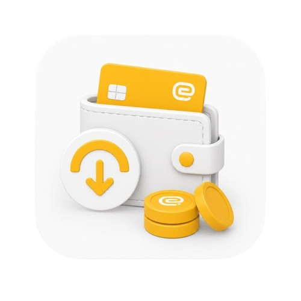

<p align="center">
  
</p>

<h1 align="center">💰 Dompi — Smart Personal Finance Tracker</h1>

<p align="center">
  <b>A sleek, offline-first personal financial manager built with Flutter, featuring ML Kit OCR receipt scanning, interactive charts, and Excel export.</b>
</p>

<p align="center">
  
  
  
  
</p>

---

## 🌟 Key Features

* ⚡ **100% Offline-First & Privacy Focused:** Your financial data stays securely on your device. Zero external tracking, zero unwanted latency.
* 🧾 **AI-Powered Receipt OCR Scanner:** Scan shopping receipts and paper notes instantly into transactions using **Google ML Kit Text Recognition**.
* 📊 **Interactive Analytics & Financial Charts:** Visual monthly cash flow and expense breakdowns powered by **`fl_chart`**.
* 📁 **Export to Excel (`.xlsx`):** Generate spreadsheet reports with a single tap for budgeting, tax records, or backup.
* 🎨 **Modern Dark Binance-Inspired UI:** High-contrast, eye-friendly dark design with fluid physics animations powered by **`flutter_animate`**.
* 🔍 **QR / Barcode Scanner Integration:** Quick barcode recognition support via **`mobile_scanner`**.
* 🇮🇩 **Localized for Indonesia:** Native support for Rupiah (`IDR`) currency formats and Indonesian date formats.

---

## 🏗️ Architecture & Tech Stack

* **Framework:** Flutter 3.x (Dart 3.x)
* **Design Pattern:** Service-oriented architecture with clean separation of UI and business logic
* **Data Storage:** Optimized local persistent key-value & serialized storage
* **Text Recognition:** `google_mlkit_text_recognition`
* **Visualization:** `fl_chart`
* **File & Sharing:** `excel`, `path_provider`, `share_plus`
* **UI & Animation:** `google_fonts`, `flutter_animate`, `animations`

---

## 🚀 Getting Started

### Prerequisites
* Flutter SDK (`>= 3.4.0 < 4.0.0`)
* Android Studio / VS Code
* Android SDK (API level 21+)

### Installation

1. **Clone the repository:**
   ```bash
   git clone https://github.com/web-personal13/pencatat-keuangan.git
   cd pencatat-keuangan
   ```

2. **Install Flutter dependencies:**
   ```bash
   flutter pub get
   ```

3. **Run the application:**
   ```bash
   flutter run
   ```

---

## 📱 Screenshots & Demo

*(Add your application screenshots here inside `docs/screenshots`)*

---

## 👨‍💻 Author

**Yuko (Yusuf Eko)**
* GitHub: [@web-personal13](https://github.com/web-personal13)

---

## 📄 License
This project is licensed under the MIT License - feel free to use and adapt!
